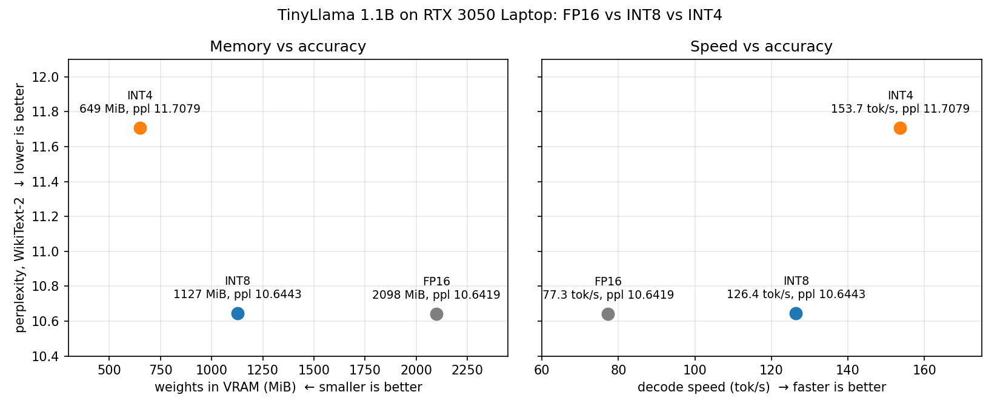
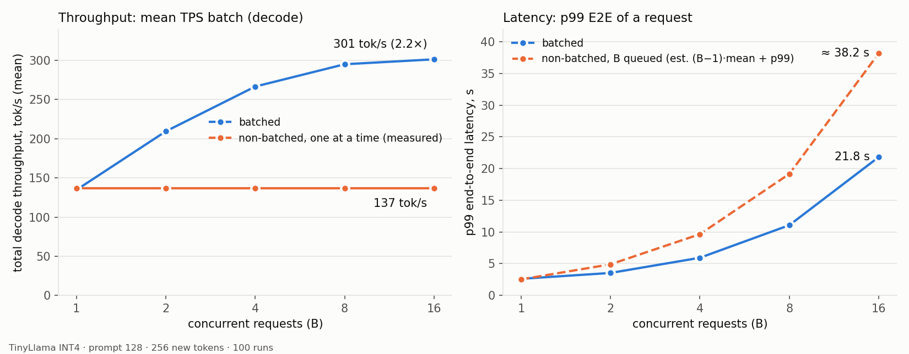

# bare-cuda-4gib

An LLM **inference engine** written from scratch in C++/CUDA. It serves TinyLlama-1.1B on a **4 GiB RTX 3050 Laptop GPU**. The runtime does not use cuBLAS, PyTorch or any other inference library: every kernel was written and tested in this repo, including the tiled GEMMs, GEMVs, attention, RoPE, RMSNorm, quantized matmuls and the paged KV cache. A small Python server on top exposes an OpenAI-style API with continuous batching.


## Hardware and Model

| | |
|---|---|
| GPU | NVIDIA RTX 3050 Laptop (sm_86), 4 GiB GDDR6 |
| peak memory bandwidth | 192 GB/s |
| peak FP32 compute | 6144 GFLOP/s (the engine does not use tensor cores) |
| power | pinned at ~60 W in every phase (laptop power cap, measured with NVML) |
| model | TinyLlama-1.1B-Chat-v1.0 |
| shape | 22 layers, hidden 2048, 32 query heads / 4 KV heads (GQA), head dim 64, MLP 5632 (SwiGLU), vocab 32000 |
| FP16 weights | 2098.2 MiB, which uses half the card on its own |


## Repository layout

| path | contents |
|---|---|
| [engine/kernels/](engine/kernels/) | CUDA kernels: `gemm_{fp16,int8,int4}`, shared `gemm_tiled.cuh`, `gemv_{fp16,int8,int4}` (single and batched), attention, softmax, rope, rmsnorm, swiglu, residual, KV write, argmax |
| [engine/src/](engine/src/) | model loader, VRAM allocator, paged KV cache, forward pass, scheduler (continuous batching), sampler, async engine, per-kernel profiler |
| [engine/tests/](engine/tests/) | one ctest per kernel or component, checked against CPU or torch references |
| [bench/](bench/) | `llm-bench` (latency, per-kernel and NVML report), `llm-ppl` (perplexity), `llm-batch-check`, `llm-infer`, and `load_test.py` |
| [server/](server/) | Python bindings and the FastAPI server (`/v1/completions`, `/v1/chat/completions`, streaming, `/metrics`) |
| [tools/](tools/) | weight converter and quantizer (`.llmbin` format), tokenizer helper, HF reference scripts |


## Summary

**Single request** (16-token prompt, 32 generated tokens, 100 measured runs, `llm-bench`):

| stage | p99 TTFT (ms) | p99 TPOT (ms) | mean decode TPS (tok/s) | p99 E2E (ms) | mean VRAM (MiB) |
|---|---|---|---|---|---|
| naive forward (recompute everything) | 68.30 | 185.58 | 6.8 | 4735 | 2114 |
| + KV cache | 65.25 | 14.69 | 77.3 | 463 | 2118 |
| + INT8 weights (group 128) | 69.9 | 9.01 | 126.4 | 315 | 1146 |
| + INT4 weights (group 128) | 68.1 | **6.54** | **153.7** | **271** | **668** |

- From the naive engine to INT4, mean decode TPS got **22.6× faster** and VRAM use **68% smaller**. The KV cache alone cut p99 TPOT **12.6×** and p99 E2E **9.7×**.
- **Batched decode** (INT4, 128-token prompts, 256 generated tokens each) reaches **301 tok/s at B=16**, 2.2× the single-stream rate.
- **Accuracy:** on WikiText-2, the engine's FP16 perplexity matches Hugging Face transformers to every printed digit (10.6419). INT8 costs +0.02% and INT4 costs +10.0%.
- **Server under load** (INT8, 128 in / 128 out, max 8 sequences): capacity is **1.05 req/s (135 output tok/s)** after the register-blocked prefill GEMM, up from 0.86 req/s.


**Terminologies**:
- **TTFT** (time to first token): how long until the first new token comes out. It is dominated by the **prefill** pass over the whole prompt.
- **TPOT** (time per output token): the time for each later token. Each of those comes from one **decode** pass.
- **E2E**: the latency of the whole request, from start to last token.


## Optimization journey

### 1. Naive forward

The first version recomputes the whole sequence for every new token. To generate token N, it runs every matmul over all N tokens again, so TPOT grows with N, and E2E grows approximately by N^2.

Benchmark: 100 runs with 16-token input prompt, generate 32 output tokens.

| p99 TTFT (ms) | p99 TPOT (ms) | mean decode TPS (tok/s) | p99 E2E (ms) | mean VRAM (MiB) |
|---|---|---|---|---|
| 68.30 | 185.58 | 6.8 | 4735 | 2114 |


### 2. KV cache

A natural optimization is to cache K and V of previously generated token, so that we do not compute them again when generating the new token. E2E grows by N instead of N^2.

Benchmark results of the same settings:

| metric | naive | KV cache |
|---|---|---|
| p99 TPOT | 185.58 ms | **14.69 ms** (12.6× lower) |
| mean TPOT, first → last token | 117 → 179 ms | 13.0 → 12.9 ms (flat) |
| mean decode TPS | 6.8 tok/s | **77.3 tok/s** |
| p99 TTFT | 68.30 ms | 65.25 ms |
| p99 E2E | 4735 ms | 490 ms (9.7× lower) |


- TTFT staying the same (as it should be): prefill is one pass over the prompt either way.
- The cache costs 2.1 MiB at just 48 tokens of context. 


### 3. Quantization

I quantized model weight from FP16 to INT4 and INT8 (group size 128), stored the corresponding quantized models. The engine load them and dequantize on the fly:

```
Python (once):   FP16 weight ── quantize ─> int + scale (+ min for INT4)   → written to .llmbin

CUDA (every pass): int + scale ── dequantize ─> FP16 weight
```

**Memory/Throughput vs Accuracy Tradeoff**

Accuracy was measured in terms of perplexity (lower is better) on WikiText-2 raw test split (335,687 ids), in non-overlapping 512-token windows (BOS + 511 text tokens), each run as a fresh prefill.




| model | weights in VRAM | decode tok/s | perplexity | vs FP16 | budget |
|---|---|---|---|---|---|
| FP16 | 2098.2 MiB | 77.3 | 10.6419 | | |
| INT8 | 1127.1 MiB (0.54x) | 126.4 (1.63x) | 10.6443 | +0.02% | ≤ +1%, passes |
| INT4 | 649.3 MiB (0.31x) | 153.7 (1.99x) | 11.7079 | +10.02% | ≤ +10%, misses by 0.002 |

- **FP16 → INT8 is nearly free:** 46% less memory and 1.63× faster decode for +0.02% perplexity.
- **INT8 → INT4 is where accuracy starts to cost.** INT4 needs 69% less memory and decodes 1.99× faster, but perplexity jumps 10%.


### 4. Paged KV cache

Paging is a better memory management technique. With a flat cache, we generally reserve memory based on the longest sequence.  Most sequences fall short of the limit (wasting like 60-80% of the reserved space). When serving requests with variable lengths, this causes fragmentation and reduces the number of concurrent executions.

The KV cache is now a shared pool of 64-token pages with a page table per sequence, so several sequences can share memory without each reserving room for the maximum length. 

Note that for single sequence serving, paged KV cache offers no real advantage. Its benefits comes from **batching** multiple requests, as shown below.


### 5. Continuous Batching


Mechanism: input prompts wait in a queue, join when a slot and KV pages are free, and leave when they finish. All active sequences share one decode pass.


Benchmark: Batch size 1, 2, 4, 8, 16. INT4 quantized model, 128-token prompts, 256 generated tokens each:

| B | p99 E2E (s) | Mean decode throughput (tok/s) | vs single stream |
|---|---|---|---|
| 1 | 2.61 | 134.7 | 1.00× |
| 2 | 3.54 | 209.5 | 1.53× |
| 4 | 5.94 | 266.7 | 1.95× |
| 8 | 11.07 | 295.1 | 2.15× |
| 16 | 21.82 | 301.4 | 2.20× |



The left panel shows throughput. On the right, the queued latency is an estimate: it assumes the B requests are served one after another, (B−1) × 2.38 s + 2.53 s.


### 6. Inference server under load

[A simple FastAPI](server/app.py) inference server wraps the engine supporting async request queue, sampling (temperature, top-p), streaming, timeouts, a 429 "server busy" response and `/metrics`. 

The load test sends 64 streamed requests per run with request rate 1, 2, 4, 8. Tested for the INT8 model, input prompt length 128 + 128 output tokens.

| offered rate (req/s) | 1 | 2 | 4 | 8 |
| --- | --- | --- | --- | --- |
| achieved (req/s) | 0.78 | 0.86 | 0.86 | 0.85 |
| output tok/s | 100.4 | 109.8 | 109.8 | 109.3 |
| mean decode batch | 4.70 | 7.82 | 7.98 | 7.98 |
| engine busy | 95% | 100% | 100% | 100% |
| TTFT p99 (s) | 6.40 | 33.6 | 51.3 | 60.8 |
| TPOT p99 (ms) | 69.3 | 69.1 | 69.2 | 70.2 |
| E2E p99 (s) | 13.8 | 41.2 | 58.0 | 66.6 |

- **Capacity is about 0.86 req/s.** Above that rate, TTFT is the time spent waiting in the queue, not compute: at 8 req/s, all 64 requests arrive in about 8 s and drain at 0.86 req/s.
- Each request costs 1/0.86 ≈ 1.16 s of engine time: 0.50 s of its own prefill and 0.66 s of decode.
- **Stall model:** every prefill pauses all running streams for about 0.5 s. A stream decoding 127 tokens sees about 8 admissions, so 41 ms per pass + 8 × 0.5 s / 127 ≈ 72 ms per token, which matches the measured TPOT p90 of 69 ms.

#### Optimize with register-blocked GEMM for faster prefill

The shared tiled GEMM (matrix multiplication) now gives each thread an 8×8 block of outputs in registers. This reduces trips to slower memory and cut coordination overhead between threads.

Benchmark results:

| offered rate (req/s) | 1 | 2 | 4 | 8 |
| --- | --- | --- | --- | --- |
| achieved (req/s) | 0.83 | 1.04 | 1.05 | 1.05 |
| output tok/s | 106.4 | 133.6 | 134.7 | 134.8 |
| mean decode batch | 3.11 | 7.44 | 7.95 | 7.98 |
| engine busy | 88% | 100% | 100% | 100% |
| TTFT p99 (s) | 2.98 | 21.0 | 37.5 | 46.6 |
| TPOT p99 (ms) | 57.0 | 57.5 | 57.2 | 57.4 |
| E2E p99 (s) | 9.0 | 27.1 | 44.2 | 52.4 |

Improvements:

| | tiled 16×16 GEMM | register-blocked GEMM | change |
|---|---|---|---|
| capacity (saturated runs) | 0.86 req/s, 110 tok/s | **1.05 req/s, 135 tok/s** | +22% |
| TPOT p99, saturated | 69 ms | 57 ms | −17% |
| fastest TPOT, alone / full batch | 8.7 / 41 ms | 8.7 / 40–41 ms | unchanged |
| engine time per request (1 / capacity) | 1.16 s | 0.95 s | −0.21 s |


## Reproduce

Requirements: a CUDA toolkit, CMake ≥ 3.21 and Python with `tools/convert/requirements.txt` and `server/requirements.txt` installed. The build targets sm_86 by default; set `-DLLM_CUDA_ARCH=<cc>` for other GPUs.

```sh
# build and test
cmake -S . -B build -DCMAKE_BUILD_TYPE=Release
cmake --build build -j
ctest --test-dir build

# convert weights (fp16, int8 or int4)
python tools/convert/convert_weights.py --model TinyLlama/TinyLlama-1.1B-Chat-v1.0 \
    --out model/tinyllama_int4.llmbin --quant int4 --group 128

# latency benchmark (add --kernels for per-kernel tables, --batch B for batching)
./build/bin/llm-bench --model model/tinyllama_int4.llmbin --prompt-len 16 --runs 100

# full report: latencies, prefill/decode split, VRAM, NVML
./build/bin/llm-bench --model model/tinyllama_int4.llmbin --prompt-len 64 --tokens 64 \
    --runs 20 --batch 4 --report bench_out/int4_b4

# perplexity
python tools/convert/tokenize_text.py --model TinyLlama/TinyLlama-1.1B-Chat-v1.0 \
    --text model/wikitext2_test.raw --out model/wikitext2_test.ids
./build/bin/llm-ppl --model model/tinyllama.llmbin --ids model/wikitext2_test.ids

# batched vs single decode correctness
./build/bin/llm-batch-check --model model/tinyllama_int4.llmbin --ids model/wikitext2_test.ids

# server and load test
python server/app.py --model model/tinyllama_int8.llmbin --tokenizer TinyLlama/TinyLlama-1.1B-Chat-v1.0
for r in 1 2 4 8; do
  python bench/load_test.py --num-requests 64 --rate $r --prompt-len 128 --max-tokens 128 --out load_r$r.json
done
```

## LICENSE

[Apache 2.0](LICENSE)